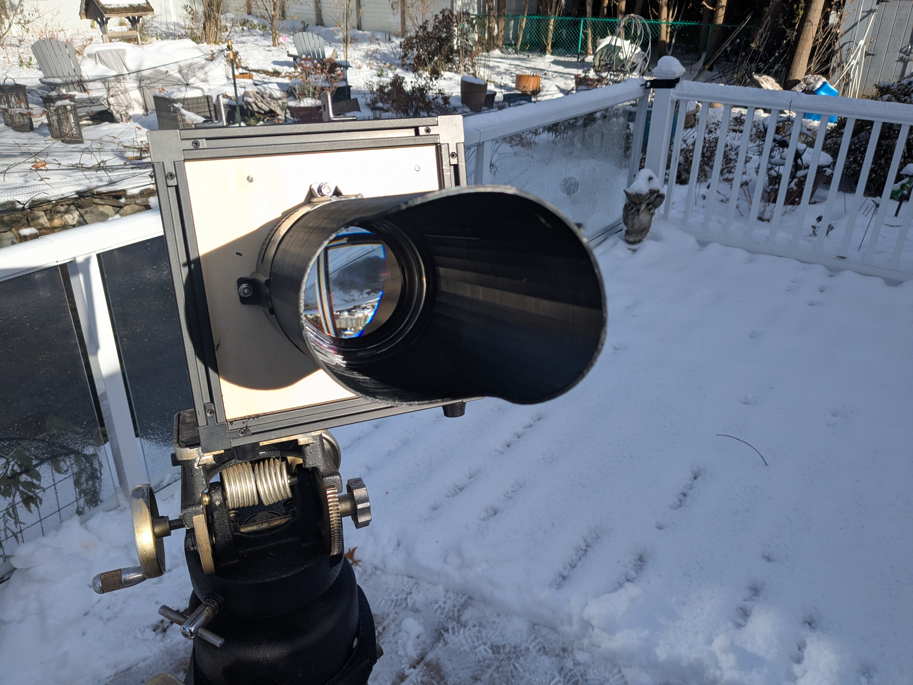

A sun shield for the Delta II lenses. 

The design is inspired by photography or stage light modifiers called ["snoots"](https://en.wikipedia.org/wiki/Snoot). 
The cutaway is inspired by traffic lights, and is intended to minimize sun flare in the field of view.

 There are two versions. One is just the shield/hood. The other adds a ridge/spine for strength, and may also be useful for 
aligning the long side with the angle to the sun.
 
I haven't looked at this in a little while, so I'm not sure if the primary design file is the scad file, or the FreeCAD file. 
I might have even started with OpenSCAD, then imported that into the FreeCAD OpenSCAD workbench.

- sun_baffle.FCStd - FreeCAD source
- sun_baffle.scad - OpenSCAD source, probably imported to the FreeCAD project, using the OpenSCAD workbench in FreeCAD
- sun_baffle.stl - the basic baffle
- sun_baffle-union002.stl - the baffle with the strenging and aligning ridge
